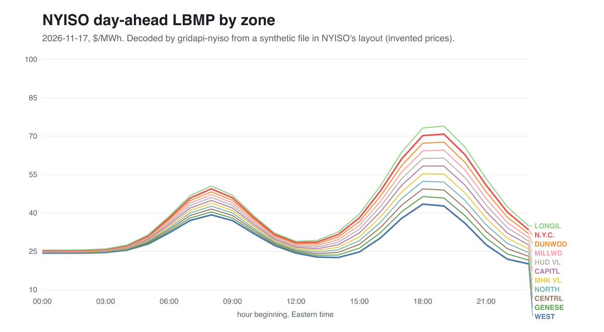
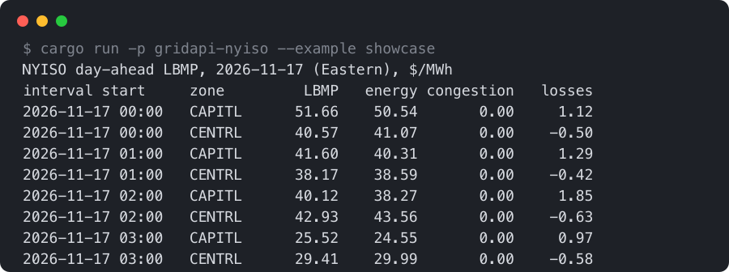

# gridapi

Typed, async Rust clients for eleven North American power-market data sources (ERCOT, PJM, CAISO, NYISO, ISO-NE, MISO, SPP, IESO, AESO, EIA and Grid Status), so you can pull prices, load and generation mix without writing a CSV scraper per grid operator.



The chart above is drawn from rows decoded by `gridapi-nyiso`: the client fetched a day-ahead zonal file from a local mock server, parsed the Eastern-time stamps and split each LBMP into energy, congestion and losses. The file has NYISO's real layout; the prices are invented, so the repository carries no upstream data. Reproduce every image with `docs/showcase/make-screenshots.sh` (see [docs/showcase.md](docs/showcase.md)).

The same decode as terminal output:



## Install

These crates are not on crates.io. Add the one you need as a git dependency:

```toml
[dependencies]
gridapi-nyiso = { git = "https://github.com/davidawad/gridapi", package = "gridapi-nyiso" }
```

Pin `rev = "<commit>"` or `tag = "<tag>"` for reproducible builds. Every crate is async (`tokio` plus `reqwest` with rustls, no OpenSSL), has no global state, and retries 429, 5xx and transport errors with jittered backoff.

Build everything: `cargo build --workspace`. The offline tests need no network or keys: `cargo test --workspace`.

## Crates

| Crate | Upstream | Auth | Usage and details |
| --- | --- | --- | --- |
| `gridapi-ercot` | ERCOT Public API | username, password and subscription key from `ERCOT_*` env vars | [README](crates/gridapi-ercot/README.md) |
| `gridapi-pjm` | PJM Data Miner 2 | `PJM_API_KEY` (your own key from PJM's API portal) | [README](crates/gridapi-pjm/README.md) |
| `gridapi-caiso` | CAISO OASIS and Today's Outlook | none | [README](crates/gridapi-caiso/README.md) |
| `gridapi-nyiso` | NYISO `mis.nyiso.com` CSV files | none | [README](crates/gridapi-nyiso/README.md) |
| `gridapi-isone` | ISO-NE ISO Express, and Web Services v1.1 | none for ISO Express; `ISONE_USERNAME` and `ISONE_PASSWORD` for Web Services | [README](crates/gridapi-isone/README.md) |
| `gridapi-miso` | MISO Data Exchange API; public web routes are opt-in | `MISO_API_KEY` (Data Exchange); the public web routes need feature `miso-public-web` | [README](crates/gridapi-miso/README.md) |
| `gridapi-spp` | SPP portal file browser | none | [README](crates/gridapi-spp/README.md) |
| `gridapi-ieso` | IESO (Ontario) public reports | none | [README](crates/gridapi-ieso/README.md) |
| `gridapi-aeso` | AESO (Alberta) API | `AESO_API_KEY` | [README](crates/gridapi-aeso/README.md) |
| `gridapi-eia` | EIA Open Data API v2, plus EIA-860M and EIA-930 bulk files | `EIA_API_KEY` (bulk files need none) | [README](crates/gridapi-eia/README.md) |
| `gridapi-gridstatus` | Grid Status hosted API | `GRIDSTATUS_API_KEY` | [README](crates/gridapi-gridstatus/README.md) |

Keys are read from environment variables only; nothing in this repository embeds one. Minimal use, as in the render above:

```rust
use gridapi_nyiso::{chrono::NaiveDate, Client, Level};

#[tokio::main]
async fn main() -> Result<(), Box<dyn std::error::Error>> {
    let day = NaiveDate::from_ymd_opt(2026, 11, 17).ok_or("bad date")?;
    let rows = Client::new()?.day_ahead_lbmp(Level::Zone, day).fetch_strict().await?;
    for r in &rows {
        println!("{} {} {:.2}", r.timestamp, r.name, r.lbmp);
    }
    Ok(())
}
```

## Verified

Each crate was run against its live upstream on 2026-11-18 and its decoders are tested offline against small synthetic responses in `tests/fixtures` (real shapes, invented values). The per-crate README has the full table of live checks and their values. Offline suite across the workspace: 641 passed, 0 failed, 64 ignored with default features; 704 passed, 0 failed, 73 ignored with `--all-features` (the ignored tests are the live ones and need network, and for some, keys).

| Crate | Live-verified | Not verified (stated in its README) |
| --- | --- | --- |
| [`gridapi-ercot`](crates/gridapi-ercot/README.md#verified) | 14 of 14 live checks | none listed |
| [`gridapi-pjm`](crates/gridapi-pjm/README.md#verified) | 3 live tests (public-key mode, now an opt-in feature) | member-key behaviour; `download=true` and csv/xml responses are not wrapped |
| [`gridapi-caiso`](crates/gridapi-caiso/README.md#verified) | OASIS LMPs and the Today's Outlook feeds | the `#[ignore]` OASIS live suite end to end |
| [`gridapi-nyiso`](crates/gridapi-nyiso/README.md#verified) | the published datasets, 2026-11-17 | none listed |
| [`gridapi-isone`](crates/gridapi-isone/README.md#verified) | keyless ISO Express route, 8 of 10 live tests | Web Services route (no account yet; 2 tests skipped) |
| [`gridapi-miso`](crates/gridapi-miso/README.md#verified) | public API and market reports, 5 live tests (now behind the opt-in `miso-public-web` feature) | Data Exchange API (no account) |
| [`gridapi-spp`](crates/gridapi-spp/README.md#verified) | portal listing and downloads, checked with curl | the Rust live tests could not run in that session |
| [`gridapi-ieso`](crates/gridapi-ieso/README.md#verified) | 6 of 6 live tests | none listed |
| [`gridapi-aeso`](crates/gridapi-aeso/README.md#verified) | live key, 2026-11-18 | rate limits are undocumented by AESO |
| [`gridapi-eia`](crates/gridapi-eia/README.md#verified) | 7 of 7 live tests | none listed |
| [`gridapi-gridstatus`](crates/gridapi-gridstatus/README.md#verified) | free-tier key, 10 requests spent | the CAISO day-ahead query through this client |

### Feature gates for unverified methods

Anything that could not get a live pass, or that the upstream's terms put at risk, is off by default, so the default build exposes only methods checked against the real service:

| Crate | Feature | Gates | Why unverified |
| --- | --- | --- | --- |
| `gridapi-isone` | `isone-webservices` | the `webservices` module and `Credentials` (Web Services API v1.1) | untested: no ISO Express account |
| `gridapi-miso` | `miso-public-web` | the keyless website-hosted routes (`public-api.misoenergy.org`, `docs.misoenergy.org`, the retired broker); with no feature the crate has no request-making method | MISO's website terms bar automated access (see below); verified live, but off by default |
| `gridapi-pjm` | `pjm-public-web-key` | `KeyMode::PublicWebApp`, the key PJM's own web app ships; also needs `ClientBuilder::i_accept_pjm_public_key_risk()` | outside PJM's documented route for automated access; `KeyMode::Auto` reads `PJM_API_KEY` only |
| `gridapi-miso` | `miso-dataexchange` | the keyed Data Exchange API (`data_exchange_page`, `pricing_page`, `ClientBuilder::api_key`) | untested: no MISO account |
| `gridapi-gridstatus` | `unverified` | the `time_comparison` and `publish_time*` query setters | no live request reached a dataset with a publish-time column |
| `gridapi-spp` | `unverified` | `Chart::GenMixSwpw` | the endpoint answered HTTP 404 on 2026-11-18 |

Enable one with, for example, `gridapi-isone = { git = "https://github.com/davidawad/gridapi", package = "gridapi-isone", features = ["isone-webservices"] }`.

## Terms of the upstream data

This is a client library; it grants you no rights to anyone's data. Each upstream sets its own terms, several are restrictive, and the terms bind you, the user. Read them before you use or republish what these crates return, register your own accounts, and do not share credentials. Quotes and clauses below were read on 2026-11-19; terms change without notice, so re-read them. This is not legal advice.

| Upstream | What the terms say | Source |
| --- | --- | --- |
| PJM | Data Miner data is for internal use only; redistribution of data contained in or derived from it is prohibited without an active PJM membership, and non-members may not republish data. Non-members are limited to 6 requests per minute and may use the data for internal business only. PJM's documented route for automated queries is a registered PJM account and your own key. The subscription key PJM's own web app ships is not issued to you, so `gridapi-pjm` never uses it by default: that mode is an opt-in cargo feature (`pjm-public-web-key`) behind an explicit acknowledgement in code. | [Data Miner 2 API guide (PDF)](https://www.pjm.com/-/media/DotCom/etools/data-miner-2/data-miner-2-api-guide.pdf), [Data Miner 2 terms of use (PDF)](https://www.pjm.com/-/media/DotCom/etools/edatafeed/data-license-agreement-edata-feed-data-miner-2.pdf) |
| MISO | The website terms bar "any automated means, including, without limitation, agents, robots, scripts, or spiders, to access, monitor, or copy any part of this Website" and bar reproducing or publishing its content. `gridapi-miso` therefore has no website-hosted route in the default build: the public API and market-report routes (`public-api.misoenergy.org`, `docs.misoenergy.org`) are the opt-in feature `miso-public-web`, to be used with MISO's permission or at your own risk. The keyed Data Exchange API is the supported route (feature `miso-dataexchange`, untested: no account). | [MISO legal and privacy](https://www.misoenergy.org/meet-miso/legal-and-privacy/) |
| Grid Status | A hosted third-party aggregator; the licence is for your own internal use with your own plan and API key, and you may not share the key. The terms bar using the service to build a competing product and bar publishing a product that substantially reproduces or substitutes for the service. `gridapi-gridstatus` is a thin optional adapter to the documented public API; it needs your own Grid Status plan. Attribution: "Data provided by Grid Status (https://www.gridstatus.io/)". | [Grid Status terms of use (PDF)](https://gridstatus.io/legal/terms_of_use.pdf) |
| ERCOT | You must create your own account with your real name; bot-registered accounts and misrepresenting your identity are not permitted, credentials may not be shared, and ERCOT sets and enforces usage limits. The Data Access Portal terms say you may not download the same report more than three times within a 12-month period; the archive helpers do not enforce this, so download each report once and keep it. The website terms let contents be redistributed unmodified with notices kept, and reserve the ERCOT name and logo. | [ERCOT API terms (data portal)](https://www.ercot.com/help/terms/data-portal), [ERCOT website terms](https://www.ercot.com/help/terms) |
| AESO | Material may be used and copied for non-commercial, personal or educational purposes if unmodified with copyright notices kept. Any other use needs the AESO's written permission. | [AESO legal](https://www.aeso.ca/legal/) |
| IESO | A limited, non-exclusive, non-sublicensable licence to use and reproduce the content, provided this line is included on all reproductions: "Copyright © 2004-2026 Independent Electricity System Operator, all rights reserved. This information is subject to the Terms of Use set out in the IESO's website (www.ieso.ca)". Other uses need written permission. | [IESO terms of use](https://www.ieso.ca/terms-of-use) |
| SPP | Permission to copy and distribute with citation, except in a commercial publication; any commercial use needs prior written authorisation from SPP. Its acceptable-use policy covers programmatic access and asks for approval before polling faster than needed. Source: Southwest Power Pool. | [SPP terms and conditions](https://www.spp.org/terms-conditions/) |
| CAISO | The CAISO API licence is revocable and limited to use under its terms: no excessive load on production systems, no use for monitoring or benchmarking CAISO systems. CAISO states it owns CAISO Data. Materials may be used with copyright notices intact and credit to the California ISO. Contains data from the California ISO. | [CAISO privacy and terms of use](https://www.caiso.com/privacy-terms-of-use) |
| ISO-NE | Content is protected by copyright; duplication or non-personal use may violate copyright (contact info@iso-ne.com for permission). You may not overburden its servers, and ISO-NE may throttle excessive or invalid requests. The Web Services API needs an account and has terms I have not read because I have no account. | [ISO-NE legal and privacy](https://www.iso-ne.com/legal-privacy) |
| NYISO | The site reserves all rights and confers no licence; downloading or republishing its images and video as stand-alone files is prohibited, and its logo needs permission. I found no separate data licence for the `mis.nyiso.com` CSV files. | [NYISO legal notice](https://www.nyiso.com/legal-notice) |
| EIA | U.S. government publications are public domain; you may use and distribute the data. EIA asks for an acknowledgment that includes the publication date, you may not imply endorsement, you may not modify content and still claim EIA as the source, and the EIA logo needs permission. Programs must throttle their requests. | [EIA API terms of service](https://www.eia.gov/opendata/terms-of-service.php), [EIA copyrights and reuse](https://www.eia.gov/about/copyrights_reuse.php) |

The test fixtures (`crates/*/tests/fixtures`) are synthetic: they keep each upstream's real response shapes, field names, timestamps and station names, with the numeric values replaced by invented ones, so this repository carries none of the upstream data. The exception is `gridapi-eia`, whose fixtures are excerpts of real EIA responses (U.S. government work, public domain; source: U.S. Energy Information Administration, retrieved 2026-11-18). The ISO-NE Web Services JSON fixtures were authored from its published documentation. The "Verified" sections in the crate READMEs record the method, date, pass/fail and row counts of the live runs, and deliberately omit the prices, loads and other values the upstreams returned. Live tests are `#[ignore]`d: run them only on your own machine with your own credentials, never in public CI.

gridapi is an independent, unofficial client library. It is not affiliated with, endorsed by, or sponsored by ERCOT, PJM Interconnection, California ISO, NYISO, ISO New England, MISO, Southwest Power Pool, IESO, AESO, the U.S. Energy Information Administration or Grid Status Inc. All trademarks and names belong to their owners and are used only to identify the services the library talks to. No upstream data is redistributed by this repository; fixtures are synthetic except EIA fixtures, which are U.S. government public-domain data. Users must obtain their own credentials, follow each upstream's terms, and not share credentials.

## Licence

GPL-3.0-or-later. See [LICENSE](LICENSE). Copyright (C) 2026 David Awad.
