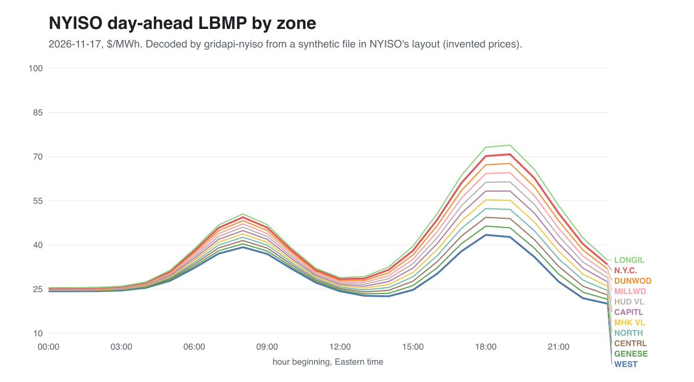
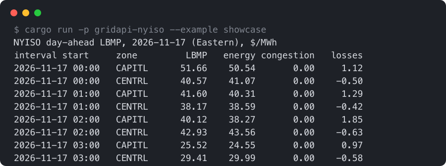

# Showcase

Every image here is generated offline: no network, no API keys, no upstream calls. The examples serve a synthetic NYISO day-ahead file (the real file layout, invented prices) from a local mock server and decode it with `gridapi-nyiso`.

Regenerate all of them from the repository root (needs cargo and `rsvg-convert`, e.g. `brew install librsvg`):

```sh
docs/showcase/make-screenshots.sh
```

The script fails if any PNG reaches 300 KB.

## Day-ahead LBMP by zone



Source: `crates/gridapi-nyiso/examples/showcase_chart.rs` writes `showcase/nyiso-zones.svg`; `rsvg-convert` renders it to `showcase/nyiso-zones.png`.

```sh
cargo run -p gridapi-nyiso --example showcase_chart > docs/showcase/nyiso-zones.svg
rsvg-convert -w 1200 docs/showcase/nyiso-zones.svg -o docs/showcase/nyiso-zones.png
```

## Terminal output



Source: `crates/gridapi-nyiso/examples/showcase.rs`. The plain text is `showcase/nyiso-day-ahead.txt`; the script wraps it into `showcase/nyiso-day-ahead-terminal.svg` and renders the PNG.

```sh
cargo run -p gridapi-nyiso --example showcase > docs/showcase/nyiso-day-ahead.txt
```

## Other runnable examples

These hit the live upstreams and need network (and a key where noted); they are not part of the checked-in corpus.

```sh
cargo run -p gridapi-caiso --example hub_prices -- 2026-11-10
cargo run -p gridapi-nyiso --example fetch
GRIDSTATUS_API_KEY=... cargo run -p gridapi-gridstatus --example live_check
```
